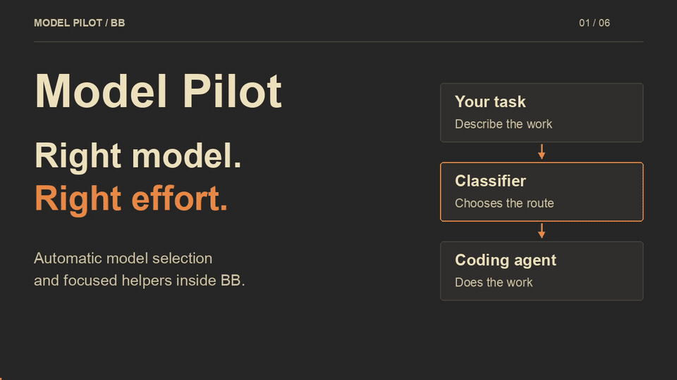

# Model Pilot for BB

AI model routing for coding agents, with automatic model selection and a token usage dashboard.

[](media/model-pilot-overview.mp4)

[Watch the 32-second overview](media/model-pilot-overview.mp4) · [Static preview](media/model-pilot-poster.png) · [Text transcript](media/model-pilot-transcript.md)

Model Pilot chooses coding models and assigns helper work inside BB.
It aims to match the model to the task instead of using the same expensive model for every request.
Choose an available BB model as the classifier and keep your existing Codex or Claude Code sign-in.
Native BB classification does not require a separate API key.
Native classifiers can inherit provider instructions and skills, which add overhead.
Your provider subscription limits still apply.
A classifier is a model that decides how the task runs.
The classifier chooses the work, and the selected coding agent does it.

Model Pilot does not guarantee lower costs, fewer tokens, or better results.
Its usage page shows the recorded work and the assumptions behind its cost estimates.
Start with ordinary tasks and compare the results before you depend on a classifier for important work.

## Install

Version 0.4.1 is an experimental BB plugin for BB 0.46 on macOS.
It uses internal BB provider bridges, so a BB update can break compatibility.
Other platforms and BB versions do not have verified support.
Native classification was tested with Codex CLI 0.162.1 and Claude Code 2.1.300 command interfaces.
Older command-line versions can reject the required isolation flags.
Make sure that your BB version matches before installation.
Coding model access depends on your Codex and Claude Code accounts.

Install the tagged release in BB with this command.

```sh
bb plugin install 'git:https://github.com/MahmoudElsayad/bb-model-pilot.git@^0.4.0'
```

Add the publisher catalog to discover Model Pilot in BB before Community marketplace review finishes.

```sh
bb marketplace add git:https://github.com/MahmoudElsayad/bb-model-pilot.git@main
```

The BB Community marketplace submission is pending.
Direct Git installation does not depend on marketplace approval.
The source uses the MIT license and accepts contributions through GitHub pull requests.
Read [CONTRIBUTING.md](CONTRIBUTING.md) before you make a change.

## Connect your BB model
Model Pilot reads the available models from BB's installed Codex and Claude Code providers.
The model list reflects the provider catalog that BB exposes.
An entry in that catalog does not guarantee account access or available quota.

1. Sign in to Codex or Claude Code through BB.
2. Open Model Pilot in the BB navigation.
3. Open Connection.
4. If a connection already exists, select Change connection.
5. Choose a Classification model.
6. Select Connect and test.
7. Create a BB thread and select Model Pilot.

Native classification runs through the installed Codex or Claude Code command-line program with your existing sign-in.
The connection test consumes provider usage and can encounter subscription limits.
Model Pilot does not include extra credits or bypass provider limits.
The Guide tab explains routing, helpers, privacy, and usage inside BB.

## Classifier choices

Choose a smaller available model when you want to limit classification overhead.
The selected classifier must return the routing choices that Model Pilot requests.
Native Codex and Claude Code classification uses your existing agent sign-ins.
A model's routing quality depends on the tasks and the provider's responses.
Successful connection tests establish a working response, not equivalent routing quality across models.

Existing Jev configuration remains available as an optional advanced mode through BB plugin settings.
Jev uses a separate API key and API billing.
Its default model is `jev-latest`.
It retains the original routing policy's TypeSafe judgments and probabilities.
Get an optional Jev key through the [TypeSafe console](https://console.typesafe.ai).
The legacy direct OpenAI and Anthropic API adapters also require separate API keys through BB plugin settings.
They use fixed official endpoints and structured response formats.
A native BB model does not need those API adapters or keys.

## How the work flows

The first message determines the main coding model, reasoning effort, and context window.
Reasoning effort controls how much reasoning the model attempts.
The context window limits the conversation that the model can receive.
Later messages retain the main model and its conversation history.
The classifier then chooses direct work, a helper, or a routed plan.

A helper is a separate agent with a focused task.
It starts with its own context and receives a task brief rather than the complete parent conversation.
The parent must include the facts, paths, and expected result that the helper needs.
Helpers inherit the parent's permission mode.
The plugin archives completed helpers and releases their runtimes.

The `auto_plan` tool assigns plan steps.
The `auto_delegate` tool runs an assigned helper.
The `auto_step_done` tool records a completed main step.
Background helpers return their reports through BB's child thread mechanism.
Foreground helpers return their reports through the tool result.
The main agent remains responsible for the final result.

## Routing in the thread

Each routed message starts with one route row.
The first message shows "Routed to" and the main model, for example "Routed to Opus 5.5".
Later messages show "Continued on" and the same model.
The row also shows the effort and the context window.
If the classifier chose a helper or a plan, the row shows it too.
Expand the row to read why the classifier chose that route.
A "Fallback route" badge means that classification was unavailable.

A plan row shows the number of steps and the helper models.
Expand it to see who does each step.
Each helper row shows the helper's model, effort, and plan step.
Background helpers show "Started background helper" because their reports arrive later.

For example, a short explanation can stay with a smaller model.
A larger implementation can use a stronger main model and focused helpers.
A helper also adds classification work, context, and agent usage.
Delegation only reduces cost when those extra costs remain below the alternative.

## Read the usage page

Open Model Pilot, then Usage, to view recorded tokens, cost trends, model shares, and recent threads.
Use the date filter to choose a period.
Use the cost and token controls to change the chart.
Select a thread to inspect its recorded work.
The view includes helpers and recorded classifier input and output usage.
Native classifier cost remains unknown in this release, so its baseline savings estimate stays hidden.
Recorded token counts do not determine what a provider subscription charges.

The comparison applies another model's price to the same recorded agent tokens.
It answers a price scenario, not whether another model can finish the task with those tokens.
It does not measure task quality or actual token savings.
Unknown prices suppress the savings estimate.
Agent prices use the bundled T3 snapshot from October 2-3, 2026.
Jev cost uses its bundled rate.
OpenAI and Anthropic classifier prices use an October 15, 2026 snapshot of official rates.
GPT-5.6 Luna costs $0.20 per million input tokens and $1.20 per million output tokens.
Its cached input rate is $0.02 per million tokens.
Haiku 4.5 costs $1 per million input tokens and $5 per million output tokens.
Its cached input rate is $0.10 per million tokens.
Unknown models or missing usage leave classifier cost unknown and suppress the savings estimate.
See the [OpenAI model page](https://developers.openai.com/api/docs/models/gpt-5.6-luna) and [Haiku 4.5 overview](https://platform.claude.com/docs/en/models/haiku-4-5/overview) for the source rates.

Provider invoices can differ because of subscriptions, discounts, cache rules, or unrecorded work.
The page does not replace provider billing records.
The dashboard reads at most 100 history records per session.
Host ledgers can retain more records until a file exceeds 2 MB.
On the next write, the plugin trims that ledger to its latest 100 records before it appends another record.
The dashboard reads at most 500 sessions and 5,000 records from the selected host.
For truncated history, it excludes an initial cumulative usage checkpoint rather than inventing the missing period.
Older work can therefore fall outside the displayed totals.

## Privacy and credentials

The chosen classifier receives task text and routing questions.
Routing requests can also include plan text and helper briefs.
The current implementation limits routing text to 12,000 characters.
Native classification sends those requests through the installed Codex or Claude Code program with your existing sign-in.
Review your chosen provider's data policies before you send confidential work.

BB manages native provider sign-ins.
Optional API modes use BB secret storage and private host provisioning.
Host credential files use owner-only permissions, `0600`.
The page receives status rather than a saved secret.
Never put a key in chat, a screenshot, a source file, or a command argument.
Read [PRIVACY.md](PRIVACY.md) for stored fields, retention, and removal limits.

## Connection problems

If the BB model list is empty, make sure that a supported native provider is installed and available in BB.
If Codex or Claude Code requests a login, sign in through its existing BB integration.
If your account lacks model access or quota, choose an available model or restore access with the provider.
A catalog entry does not guarantee that your account can start that model.

If an optional API connection fails, make sure that its separate API account has credit and model access.
A coding subscription does not supply API credit for those optional modes.
If a legacy API key is invalid or revoked, create a replacement with that provider.
Update its corresponding BB plugin setting.

If classification fails during work, the routing policy can choose its Opus medium fallback.
That fallback can cost more than the expected route and still requires access to its coding provider.
The usage page records fallback activity.
Inspect repeated fallbacks before you continue a large workload.

## Commands and compatibility

Run this command to preview classification without starting a coding agent.
The preview still consumes usage through your selected classifier.

```sh
bb auto route 'Explain what this function does.'
```

Run this command to inspect a thread's route, plan, history, and estimated usage cost.
Replace `<thread-id>` with the BB thread identifier.

```sh
bb auto status --thread <thread-id>
```

The display name is Model Pilot.
The plugin identifier remains `auto-router`, and the provider identifier remains `auto`.
Existing commands, tool names, and installation references retain those identifiers.
The original Jev routing core and model descriptions come from the T3 Code Auto patch.
The `routing/provenance.json` file records source hashes.
The default configuration keeps `toolsOnPickedThreads: false`, as the original patch does.

This adapter supports BB 0.46 on macOS, bridge protocol 2, and grammar version 3.
It uses BB's bundled provider bridges because the public SDK does not export reusable Codex and Claude factories.
A BB update can require an adapter update.
Read [the release requirements](PUBLIC-RELEASE.md) before public distribution or installation on other hosts.
Read [PRIVACY.md](PRIVACY.md) for stored fields, retention, and credential removal.
Read [SECURITY.md](SECURITY.md) to report a vulnerability without sharing secrets publicly.

## Development and contributions

Read [CONTRIBUTING.md](CONTRIBUTING.md) for installation, test commands, and pull request guidance.
Keep the supplied pnpm configuration and its seven-day package cooldown.
The tests cover routing parity, classifier failures, native sessions, permissions, plans, helpers, cleanup, and BB bridge conformance.
Successful requests to each classifier still depend on valid provider credentials and model access.
Test coverage does not establish equivalent routing quality across classifiers.

Model Pilot is licensed under [MIT](LICENSE).
The copied T3 Code portions retain their [upstream MIT notice](notices/T3-CODE-LICENSE.txt).

## Find and discuss the project

Use [GitHub issues](https://github.com/MahmoudElsayad/bb-model-pilot/issues) for reproducible problems and feature proposals.
The usage dashboard covers token usage, classifier overhead, helper activity, and cost estimates.
